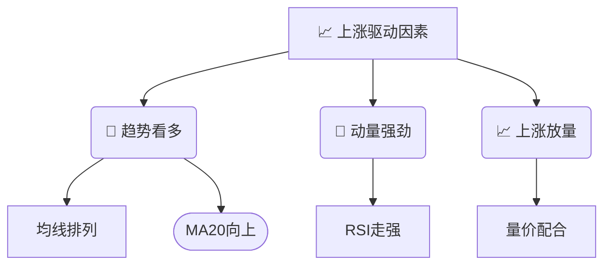

# 大盘技术指标关联网络系统

## 📋 功能概述

这个系统可以：
1. **分析技术指标之间的因果关系** - 哪些指标会导致上涨/下跌
2. **生成树形可视化图谱** - 直观展示市场涨跌的驱动因素
3. **多层级关联分析** - 从底层指标 → 中层信号 → 顶层结果（涨/跌）
4. **多格式输出** - 文本树、Mermaid流程图、JSON数据（供前端渲染）

## 🌲 关联网络结构

```
市场结果（涨/跌）
├─ 一级因素：趋势
│   ├─ 二级因素：均线排列
│   │   └─ 三级指标：MA20/60/120/250
│   └─ 二级因素：动量
│       └─ 三级指标：RSI
├─ 一级因素：资金
│   └─ 二级因素：成交量
│       └─ 三级指标：量比
└─ 一级因素：位置
    └─ 二级因素：60日位置
        └─ 三级指标：回撤幅度
```

## 📊 六大分析维度

### 1. 趋势维度（均线）
- **多头排列** → 趋势向上 → 看多
- **空头排列** → 趋势向下 → 看空
- **均线交织** → 震荡市 → 中性

### 2. 动量维度（RSI）
- **RSI > 70** → 强势/超买 → 看多（但有回调风险）
- **RSI 50-70** → 健康强势 → 看多
- **RSI 30-50** → 弱势 → 看空
- **RSI < 30** → 极弱/超卖 → 看空（但有反弹机会）

### 3. 量能维度（成交量）
- **上涨放量** → 资金流入 → 看多
- **下跌放量** → 恐慌抛售 → 看空
- **上涨缩量** → 量价背离 → 看空（警示）
- **下跌缩量** → 阴跌 → 弱势

### 4. 位置维度（60日相对位置）
- **高位（>80%）** → 获利盘丰厚 → 看空
- **低位（<20%）** → 安全边际高 → 看多
- **中位** → 中性

### 5. 波动率维度
- **高位 + 高波动** → 震荡加剧 → 看空
- **低位 + 高波动** → 可能筑底 → 看多
- **低波动** → 变盘前夜 → 观望

### 6. 技术形态维度
- **创20日新低** → 突破支撑 → 看空
- **20日跌幅 > 15%** → 超跌反弹 → 看多

## 🚀 使用方法

### 方法1：Python API

```python
from analysis.market_correlation_network import (
    build_correlation_network,
    generate_text_tree,
    generate_mermaid_diagram
)

# 输入市场指标数据
metrics = {
    "symbol": "sh000001",
    "name": "上证指数",
    "as_of": "2024-01-15",
    "close": 3150.5,
    "ma20": 3120.0,
    "ma60": 3080.0,
    "ma120": 3050.0,
    "ma250": 3000.0,
    "rsi14": 65.3,
    "position_60": 72.5,
    "drawdown": -8.5,
    "volume250": 1.35,
    "trend": "多头排列",
    "ret5": 4.2,
    "ma20_rising": True,
    # ... 更多指标
}

# 构建关联网络
network = build_correlation_network(metrics)

# 生成文本树（终端查看）
text_tree = generate_text_tree(network)
print(text_tree)

# 生成 Mermaid 流程图代码
mermaid_code = generate_mermaid_diagram(network)
print(mermaid_code)
# 复制到 https://mermaid.live 可查看可视化图

# 导出 JSON（供前端使用）
json_data = network.to_json()
print(json_data)
```

### 方法2：集成到现有大盘体检

在 `webui/services/market_health_service.py` 中添加：

```python
from analysis.market_correlation_network import build_correlation_network, generate_text_tree

def get_correlation_analysis(metrics: Dict) -> Dict:
    """获取市场关联分析"""
    network = build_correlation_network(metrics)

    return {
        "text_tree": generate_text_tree(network),
        "json_tree": network.to_dict(),
        "bull_signal_count": network.metadata['bull_signal_count'],
        "bear_signal_count": network.metadata['bear_signal_count'],
        "market_bias": _calculate_market_bias(network.metadata)
    }
```

然后在前端调用：

```javascript
// 获取关联分析
fetch('/api/market-health/correlation')
  .then(res => res.json())
  .then(data => {
    // 渲染树形图
    renderTreeVisualization(data.json_tree);

    // 显示市场偏向
    document.getElementById('market-bias').textContent =
      data.bull_signal_count > data.bear_signal_count ? '看多' : '看空';
  });
```

## 📈 输出示例

### 文本树输出

```
======================================================================
📊 大盘技术指标关联网络
======================================================================

指数：上证指数 (sh000001)
日期：2024-01-15
收盘：3150.50

看多信号数：5
看空信号数：1
💡 市场偏向：看多（信号差 +4）

──────────────────────────────────────────────────────────────────────

【📈 上涨驱动因素】

▸ 🔼 趋势看多
  均线多头排列，趋势向上
    🟢 均线排列
       └─ 收盘(3150) > MA20(3120) > MA60(3080) > MA120(3050) > MA250(3000)
      • MA20向上
        20日均线持续上行

▸ 💪 动量强劲
  RSI=65.3，市场强势
    🟢 RSI走强(65.3)
       └─ 动量健康上行

▸ 📈 上涨放量
  量比=1.35，5日涨4.2%
    🟢 量价配合
       └─ 放量上涨，资金积极介入

──────────────────────────────────────────────────────────────────────

【📉 下跌驱动因素】

（无明显看空信号）

======================================================================
```

### Mermaid 流程图



### JSON 输出

```json
{
  "bull": {
    "id": "bull_root",
    "type": "root",
    "label": "📈 上涨驱动因素",
    "color": "#10b981",
    "children": [
      {
        "id": "trend_bull",
        "type": "category",
        "label": "🔼 趋势看多",
        "description": "均线多头排列，趋势向上",
        "children": [
          {
            "id": "ma_bull",
            "type": "indicator",
            "label": "均线排列",
            "value": 100,
            "strength": "强烈看多",
            "description": "收盘 > MA20 > MA60 > MA120 > MA250"
          }
        ]
      }
    ]
  },
  "bear": { ... },
  "metadata": {
    "bull_signal_count": 5,
    "bear_signal_count": 1
  }
}
```

## 🎨 前端可视化建议

### 方案1：使用 ECharts 树图

```javascript
const option = {
  series: [{
    type: 'tree',
    data: [jsonData.bull],
    label: {
      position: 'left',
      verticalAlign: 'middle',
      align: 'right'
    },
    leaves: {
      label: {
        position: 'right',
        verticalAlign: 'middle',
        align: 'left'
      }
    },
    itemStyle: {
      color: function(params) {
        return params.data.color;
      }
    }
  }]
};

chart.setOption(option);
```

### 方案2：使用 D3.js 力导向图

```javascript
const simulation = d3.forceSimulation(nodes)
  .force("link", d3.forceLink(links))
  .force("charge", d3.forceManyBody())
  .force("center", d3.forceCenter(width / 2, height / 2));

// 渲染节点和连线
// ...
```

### 方案3：使用 Cytoscape.js 网络图

```javascript
cytoscape({
  container: document.getElementById('network'),
  elements: convertTreeToElements(jsonData),
  style: [
    {
      selector: 'node',
      style: {
        'background-color': 'data(color)',
        'label': 'data(label)'
      }
    }
  ],
  layout: {
    name: 'breadthfirst',
    directed: true
  }
});
```

## 🔧 API 接口设计

在 `webui/routes/market_health_routes.py` 中添加：

```python
@bp.route('/api/market-health/correlation', methods=['GET'])
def get_market_correlation():
    """获取市场指标关联分析"""
    # 获取最新指标数据
    state = market_health_service.read_state()
    metrics = state.get('metrics', {}).get('sh000001', {})

    if not metrics or not metrics.get('available'):
        return jsonify({"error": "指标数据不可用"}), 404

    # 构建关联网络
    network = build_correlation_network(metrics)

    return jsonify({
        "success": True,
        "data": {
            "tree": network.to_dict(),
            "metadata": network.metadata,
            "text_summary": generate_text_tree(network)
        },
        "timestamp": datetime.now().isoformat()
    })


@bp.route('/api/market-health/correlation/mermaid', methods=['GET'])
def get_market_correlation_mermaid():
    """获取 Mermaid 流程图代码"""
    state = market_health_service.read_state()
    metrics = state.get('metrics', {}).get('sh000001', {})

    if not metrics or not metrics.get('available'):
        return jsonify({"error": "指标数据不可用"}), 404

    network = build_correlation_network(metrics)
    mermaid_code = generate_mermaid_diagram(network)

    return jsonify({
        "success": True,
        "mermaid": mermaid_code,
        "timestamp": datetime.now().isoformat()
    })
```

## 📝 典型应用场景

### 场景1：市场诊断
- 快速判断当前市场多空力量对比
- 识别主导市场的核心因素
- 发现潜在的转折信号

### 场景2：策略决策
- 看多信号 > 看空信号 → 考虑做多
- 看空信号 > 看多信号 → 考虑减仓
- 信号冲突（如超卖+空头排列）→ 等待确认

### 场景3：风险提示
- 高位 + 超买 + 缩量 → 顶部风险
- 低位 + 超卖 + 放量 → 底部机会
- 多空信号平衡 → 震荡市，观望

### 场景4：回测分析
- 记录每日关联树
- 分析信号出现 → 市场走势的统计关系
- 优化信号权重和阈值

## ⚙️ 自定义扩展

### 添加新的指标维度

在 `market_correlation_network.py` 中添加新函数：

```python
def _add_sentiment_dimension(bull_root: NetworkNode, bear_root: NetworkNode,
                             metrics: Dict[str, Any]):
    """维度7：市场情绪（新增）"""
    # 从 metrics 中提取情绪指标
    fear_greed_index = metrics.get("fear_greed_index")

    if fear_greed_index is None:
        return

    if fear_greed_index >= 75:
        # 极度贪婪
        sentiment_node = NetworkNode(
            id="sentiment_extreme_greed",
            type=NodeType.CATEGORY,
            label="😱 极度贪婪",
            color="#ef4444",
            description=f"恐惧贪婪指数={fear_greed_index}"
        )
        bear_root.children.append(sentiment_node)
    elif fear_greed_index <= 25:
        # 极度恐惧
        sentiment_node = NetworkNode(
            id="sentiment_extreme_fear",
            type=NodeType.CATEGORY,
            label="😨 极度恐惧",
            color="#10b981",
            description=f"恐惧贪婪指数={fear_greed_index}"
        )
        bull_root.children.append(sentiment_node)
```

然后在 `build_correlation_network()` 中调用：

```python
def build_correlation_network(metrics: Dict[str, Any]) -> MarketCorrelationNetwork:
    # ... 现有代码 ...

    _add_sentiment_dimension(bull_root, bear_root, metrics)  # 新增

    return MarketCorrelationNetwork(...)
```

### 调整信号权重

修改各维度函数中的强度判断逻辑，例如：

```python
# 原来：RSI > 70 即为超买
if rsi14 >= 70:
    strength = SignalStrength.STRONG_BULLISH

# 调整后：更严格的阈值
if rsi14 >= 80:  # 提高阈值
    strength = SignalStrength.STRONG_BULLISH
elif rsi14 >= 70:
    strength = SignalStrength.BULLISH  # 降级为普通看多
```

## 🧪 测试

运行演示脚本：

```bash
python examples/demo_market_correlation_network.py
```

查看四种市场状态的关联分析：
1. 牛市行情
2. 熊市行情
3. 震荡市
4. 超卖底部（多空信号并存）

## 📚 相关文件

- `analysis/market_correlation_network.py` - 核心模块
- `analysis/market_diagnosis.py` - 综合诊断模块（单独的评分系统）
- `examples/demo_market_correlation_network.py` - 演示脚本
- `webui/services/market_health_service.py` - 大盘体检服务（集成点）

## 🔗 扩展阅读

- [Mermaid 语法文档](https://mermaid.js.org/)
- [ECharts 树图](https://echarts.apache.org/examples/zh/editor.html?c=tree-basic)
- [D3.js 力导向图](https://observablehq.com/@d3/force-directed-graph)
- [Cytoscape.js 网络图](https://js.cytoscape.org/)

---

**注意事项**：
1. 本系统基于历史统计规律，不保证未来预测准确性
2. 所有信号仅供参考，不构成投资建议
3. 实际交易需结合基本面、宏观环境等多方面因素综合判断
